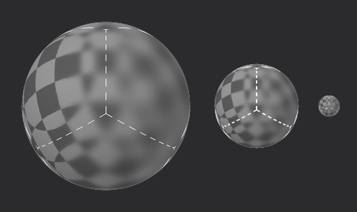
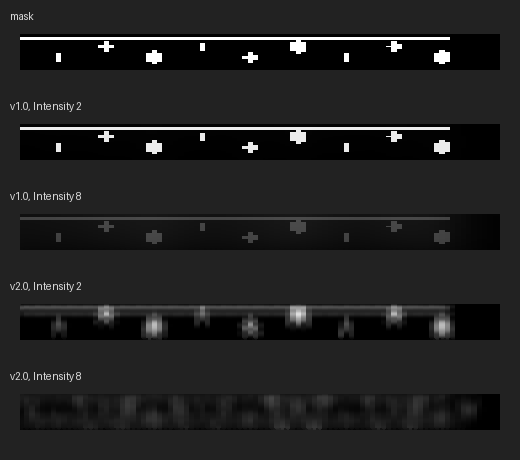
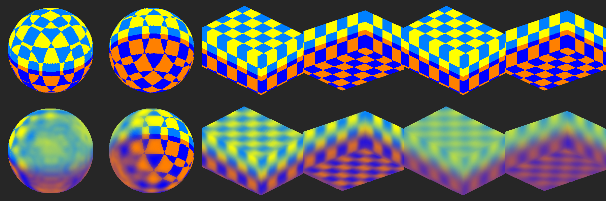
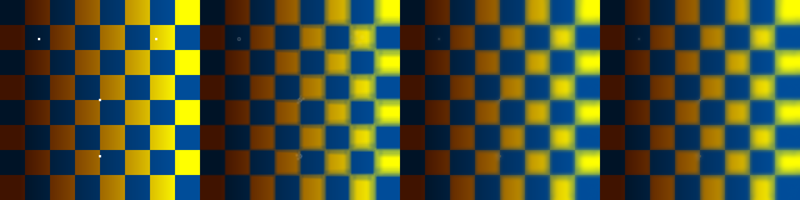
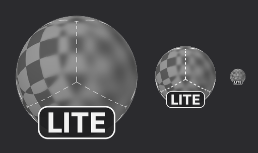

# World Space Non Uniform Blur

A Substance Designer / Substance Painter filter that does the **Non-Uniform Blur**
(bokeh blur scaled by a blur map, with Samples / Intensity / Anisotropy / Blades / Angle)
**in 3D, using the mesh position**, so the result is continuous across UV seams.
It is built on the same voxelization as *World Space Mask Blur v2.1*.

There are two packages: the full filter, and **Lite** (`world_space_non_uniform_blur_lite_v1.0.sbs`),
which does the same blur with half-size voxel tables and no Softness, for 1.5 – 1.9× less work per
evaluation than v2.1 (see [Lite](#lite)).

`world_space_non_uniform_blur_v2.1.sbs` (**version 2.1**, set by `VERSION` in `tools/build_wsnub.py`; it goes in the file name and the graph descriptions) contains one graph, `world_space_non_uniform_blur`. Use it on any channel, colour or grayscale,
and in masks: a grayscale input is read as grey and blurred the same way. (Up to v2.0 there was
also a separate `_grayscale` graph; it was only this one with a conversion on each side.)

Icon (made by `tools/make_icon.py` in the style of the World Space Mask Blur icon, embedded in the graph): the grey test sphere seen at the corner where three UV islands meet, its seams dashed. Its 3D checker is blurred by the filter itself with a left → right blur map, from crisp to melted, continuous across the seams.



## Inputs

| Input | |
|---|---|
| Input | the image to blur |
| Blur Map | optional grayscale map that scales the blur per texel (white = full Intensity, black = none). Only used when **Use Input As Blur Map** is off. |
| Mesh Position | the baked position map |
| Mesh UV Mask | the UV mask (texels outside it are passed through) |

## Parameters

**Blur** (same meaning as the 2D Non-Uniform Blur)

- **Samples** (1–16): the number of blur passes. Each pass averages the centre with `Blades` taps on a polygon, and the radius shrinks from pass to pass, which fills the bokeh shape.
- **Intensity**: the blur radius, in the same units as the 2D filter (1 = 1/256 of the UV space; default 10). It is converted to world space using the mesh's average texel density, so islands with very different texel density blur by the same world size rather than by the same number of pixels. It doesn't depend on how far apart the pieces are laid out.
- **Anisotropy**: squashes the shape across the Angle direction (1 = a line).
- **Blades** (1–9): the number of polygon sides.
- **Angle**: rotation of the shape around the surface normal.
- **Use Blur Map** (on by default): scale the blur per texel. When off, the blur is uniform.
- **Use Input As Blur Map** (on by default): use the luminance of the Input itself as the blur map, like plugging the layer below into both inputs of the 2D filter. Turn it off to use the Blur Map input instead.
- **Invert Blur Map**: blur the dark areas instead of the bright ones.

**World Space**

- **Softness**: blurs every tap a little. This makes the result smoother and lets the blur wrap around hard edges and curved areas. At 0 you get the sharpest bokeh shape.
- **Quality** (1–4): the voxel budget, 48³ / 64³ / 96³ / 128³ voxels, shared by all pieces.
- **Reference Axis X/Y/Z**: the object-space direction that Angle 0 points to. It is projected onto the surface. The default is +Y (up), so Anisotropy gives vertical streaks.
- **Dither**: hides 8-bit banding.

## Pieces laid out apart

A texture set often holds several pieces spread over the scene: kit pieces,
trims and props laid out side by side. v1.0 put one voxel grid around the whole
layout, so the farther apart the pieces, the bigger every voxel: blurs smaller
than a voxel fell back to the unblurred input, and the smallest real blur could be
wider than a plank. v2.0 uses World Space Mask Blur v2.0's boxes:

1. The occupied space is projected onto X: empty columns between pieces split
   it into **slabs**.
2. Each slab is split the same way along Z, or along Y if that separates more.
3. Each resulting **box** is cut down to the exact bounds of its surface. Every
   box gets its own voxel grid, all with one voxel size, sharing the Quality budget.

The bokeh passes, their mip pyramid (Softness) and the final lookup all work
inside each box: a tap that leaves its box reads empty, like a tap that leaves the
surface. So pieces in different boxes **never blur into each other**. Pieces
closer than about 2 % of the layout's size share a box and blur together.



*A plank from a layout of 4 pieces spread over 19 units (`tools/wsb/layout_mesh.py`),
seen from above. v1.0 at Intensity 2 leaves it unblurred (the radius is below its
voxel size) and at Intensity 8 washes it out; v2.0 blurs both by the right amount.*

## How it works

1. **Voxelization** (World Space Mask Blur v2.1, vendored in `tools/wsb/` and used as is): 512×512 surface samples with area weights, a coarse sort to find the boxes, a fine sort of the samples into each box's cells.
2. **Splats**: each voxel gathers the samples of its box next to it (tent weights). One splat stores the surface normal (the dominant eigenvector of the normal tensor, so mirrored UV islands don't cancel out; mesh only), the other `(colour·w, blur amount·w)` (per stroke). Sample areas are relative to the mesh's mean sample area, so nothing depends on its size or units.
3. **Non-uniform passes** (up to 16): each voxel averages its centre and `Blades` taps. The taps sit on the 2D Non-Uniform Blur's ellipse (same angles, inner rotation, anisotropy and radius decay `exp(-2k·√(-ln 0.001)/N)` with `N = min(Samples, ⌈Intensity·π⌉)` passes), placed in the voxel's tangent plane and scaled by the voxel's blur amount. Taps read a 5-level per-box voxel mip pyramid, which is what Softness controls, so taps that leave the surface still find it.
4. **Resolve**: finds each texel's box, then a quadratic B-spline lookup in it at the texel's position (27 voxels around the nearest one; v2.0 used a cubic one, 64 voxels). It is blended with the original texel where the local radius is below about 2 voxels, so unblurred areas stay sharp.



Flat-plane comparison with the 2D Non-Uniform Blur (v1.0; input used as its own blur map, Intensity 10): input, 2D filter, this filter at Softness 0.25, this filter at Softness 0. v2.0 is 10× closer to the 2D filter on this plane (see below).



## Quality and performance

Current totals per evaluation are in [Total work per evaluation](#total-work-per-evaluation-and-skipping-what-isnt-used)
below; the three tables before it are the history (v1.0 → v2.0 → its speed-ups → v2.1), measured
before the skipping.

Measured by running v1.0 and v2.0 through the interpreter at full size, Quality 4,
Intensity 10, 4 Samples (`tools/bench_v2.py`). Work is counted as executed: texture reads and
function-node evaluations with every loop at its real length and both sides of every If/Else,
so it's an upper bound, not a timing. The full-resolution pass (the final lookup) is scaled to a
**2048² texture**.

| Scene | Finest voxel v1.0 → v2.0 | Per stroke (reads / node evals) v1.0 → v2.0 | Once per mesh or Quality v1.0 → v2.0 |
|---|---|---|---|
| Sphere (one object) | 0.0164 → 0.0161 (1.0×) | 1.58 G / 51 G → **1.20 G / 43 G** (−24 %) | 0.29 G / 8 G → 1.98 G / 41 G |
| Kit layout, 4 pieces | 0.158 → 0.0120 (**13×** finer) | 1.55 G / 52 G → 1.38 G / 52 G | 0.29 G / 8 G → 1.97 G / 41 G |
| Flat plane | 0.0081 → 0.0014 (5.9× finer) | 1.79 G / 68 G → 2.09 G / 90 G | 0.29 G / 8 G → 1.87 G / 39 G |

* **Per stroke** = what reruns when you paint below the filter or move a Blur slider.
  It's lower on the sphere because the normals splat no longer reruns per stroke and
  the colour splat skips empty voxels. On flat pieces it's higher: the grid now follows
  the piece's proportions, so more voxels hold surface (which is also why it's so much closer to
  the 2D filter there: mean difference 0.0133 → **0.0013**).
* **Once per mesh or Quality**: two sorts instead of one, the boxes, and the normals
  splat. (This assumed Painter caches it; it appears to recompute everything on every change,
  see the totals below.)
* If it's still slow: lower **Quality** (3 is about half the work of 4), and apply the
  filter only to the channels that need it, since Painter runs a filter once per channel.

### Speed-ups that don't change the result

Ported from World Space Mask Blur (`ef8f9ed`). Each only skips work whose result is already
known; `tools/build_wsnub.py` builds them by default (`build(fast=True)`), and `fast=False`
builds the plain graph they're tested against.

1. **Resolve**: the 27 voxel reads run in 3 loop steps of 9 (instead of 27 of 1; in v2.0, 64 reads
   in 16 steps of 4), added in the same order with the same weights. Texels with nothing to blur (outside the UV islands,
   in no box, or with a black blur map) already skipped the reads and keep the input.
2. **Normals splat**: per Quality change, `WSB_NearX/Y/Z` mark sort cells with an occupied cell
   within `ceil(h / hs) + 1` cells (more than a voxel's walk reaches); voxels whose cell isn't
   near skip the walk, whose sum would be 0. (Left out again once the walk itself became cheap,
   see below.) The colour splat already skips voxels whose normal
   splat is empty. The bokeh passes and mips reach much farther, so they're left as they are.
3. **Both splats** read each sample from copies in sorted order (`WSNB_SortedPos`: position and
   relative area, `WSNB_SortedNormal`: unit normal, mesh only; `WSNB_SortedVals`: colour and blur
   amount, per stroke): 2 reads next to each other instead of 5 scattered ones.

At 2048², Quality 4, Intensity 10 (`tools/bench_v2.py`, plain → fast):

| Scene | Per stroke: reads | node evals | Once per mesh or Quality: reads | node evals |
|---|---|---|---|---|
| Sphere | 1.20 → 1.18 G (−1 %) | 42.9 → 38.4 G (−11 %) | 1.98 → 0.86 G (−57 %) | 40.9 → 26.6 G |
| Kit layout, 4 pieces | 1.38 → 1.35 G (−2 %) | 52.4 → 46.1 G (−12 %) | 1.97 → 1.00 G (−50 %) | 40.9 → 29.9 G |
| Flat plane | 2.09 → 1.99 G (−5 %) | 90.1 → 76.1 G (−16 %) | 1.87 → 1.36 G (−27 %) | 39.2 → 38.9 G |

The per-stroke gain is small because, unlike in the mask blur, most of this filter's per-stroke
work is in the bokeh passes and their mips (about 75 % of the reads), which these don't touch;
the biggest saving is in the normals splat, which reruns only when the mesh or Quality changes.

**Exactness**: `tools/test_fast_exact.py` runs the fast and the plain graph on 38 cases at
reduced sizes (box, sphere, box at 1/1000, kit layouts: 4 pieces, 6 in a row, a column along Z, a
stack along Y; every Quality; Intensity 2 – 48; voxels 1× – 47× a sort cell; Anisotropy, Angle,
Blades 3 / 9, Softness 0 / 1, Samples 1 / 16, Reference Axis, blur map off / from the input /
inverted, Dither; a grayscale input, as in a mask) and requires every output pixel to be exactly equal: all
38 are. It also builds v2.1 with v2.0's cubic lookup (`build(lookup='cubic')`), which equals the
released v2.0 (`dde603a`, built from its own sources) bit for bit on every case: the
stretched-island fix changes nothing on these meshes. The difference maps are all black
(`docs/images/fast_vs_plain_diff.png`). At the real table sizes, the three scenes above also gave 0
differing pixels between the fast and plain v2.0 (`tools/bench_v2.py` on both builds).

### v2.1: stretched UV islands and a cheaper final lookup

From World Space Mask Blur v2.1. At 2048², Quality 4, Intensity 10 (`tools/bench_v2.py`,
v2.0 → v2.1):

| Scene | Per stroke: reads | node evals | Once per mesh or Quality: reads | node evals |
|---|---|---|---|---|
| Sphere | 1.18 → 1.13 G (−4 %) | 38.4 → 34.7 G (−10 %) | 0.86 → 1.02 G | 26.6 → 29.1 G |
| Kit layout, 4 pieces | 1.35 → 1.27 G (−5 %) | 46.1 → 41.2 G (−11 %) | 1.00 → 1.16 G | 29.9 → 32.5 G |
| Flat plane | 1.99 → 1.84 G (−8 %) | 76.1 → 66.1 G (−13 %) | 1.36 → 1.52 G | 38.9 → 41.4 G |

* **Per stroke**: the final lookup reads 27 voxels per texel instead of 64. The output moves by a
  mean of 0.0001 – 0.001 on these scenes (the blur itself changes them by 0.05 – 0.25), the plane
  stays 0.0013 from the 2D filter, and it's as smooth: the mean second difference of the result
  is 0.98 – 1.04× v2.0's.
* **Once per mesh**: about 0.16 G reads more, `WSB_PackArea`'s first round over each sample's
  reads to find its texel spacing.
* **Stretched islands** (`tools/test_stretched.py`: a door frame with every face in an equal
  square UV island, the posts stretched 13:1, at 512², against the same door unwrapped in
  proportion):

  | | Samples with no area | Post texels left unblurred | Posts: difference to the proportional unwrap |
  |---|---|---|---|
  | v2.0 | 44 % | 55 % | 0.22 |
  | v2.1 | **0 %** | **0 %** | **0.017** (the lintel: 0.013) |

### Total work per evaluation, and skipping what isn't used

Painter appears to recompute the **whole** filter on every slider tick or paint stroke, mesh-only
passes included, so what counts is the total of the two columns above, not the per-stroke part.
Two things follow, both in the shipping build (`build(fast=True)`, which now also means
`skip=True`), and neither changes a pixel:

**Work that isn't used is skipped.** A Pixel Processor's If/Else evaluates both sides, but a While
loop that runs 0 times is really skipped. `When` (in `tools/build_wsnub.py`) is a loop that runs 0
or 1 times, used as an `if`; loops are nested at most two deep, and nothing read after a `When`
depends on its body having run where its condition is false.

* **Inactive pass slots.** There are 16 pass slots and `N = min(Samples, ⌈Intensity·π⌉)` run: at
  the default 4 Samples, 12 slots used to do their whole setup at every voxel (about 10 reads) and
  build their 4 mip tables. Now an idle slot reads its input (1 read per voxel) and its mips read
  nothing.
* **Mip levels no tap reads.** A tap at level `lev` reads level `⌊lev⌋` and, if `lev` has a
  fraction, the next one; `lev` grows with the radius. Each mip table is only computed if the
  pass's largest radius reaches it. At the defaults only pass 1's level 1 is; at Softness 0 none.
* **Taps** read the one or two levels they use (they used to read three and multiply the rest by 0).
* **Voxels and texels that aren't blurred**: a voxel with no surface, or with blur amount 0, skips
  the tangent frame; a texel outside the UV islands or with a black blur map reads 3 – 4 texels
  and doesn't look up its box (which is now looked up once, not twice).
* **Splats**: a loop step reads either a sample or the next cell, not both, and the sample once
  for all accumulators. So the walk over empty cells is cheap, and the four tables that avoided
  it (`WSB_SortMap`, `WSB_NearX/Y/Z`) cost more than they saved: they're gone.
* **Sample passes** (`WSB_PackArea`, `WSNB_PackNormal`, `WSNB_PackVals`): each read is tested once,
  and only the reads taken are measured; patches with no surface skip the loop.
* **Global tables** (`WSB_Bounds`, `WSB_Coarse`, the two fits, `WSB_AreaTotal`, `WSNB_Radius`) are
  16 × 16 images of which only 2 texels are ever read; the other 254 used to run the whole loop
  too. `tools/check_types.py` checks that nothing reads those.
* **Cell tables**: a cell's end is the next cell's start, so one binary search per cell instead of
  two (`WSB_Starts0/1`).
* **Features that are off**: the Blur Map input isn't read unless it's used; no dither noise at
  Dither 0; at Intensity 0 the per-stroke passes read 1 – 4 texels per voxel or texel and stop.

**Totals per evaluation** (`tools/bench_total.py`: 512² maps, full table sizes, Quality 4,
Intensity 10, Blades 5, blur map on; mesh + stroke = **total** G reads / G node evaluations).
The passes at texture size (the final lookup) are scaled ×16 for 2048² and ×64 for 4096² from the
512² run; the table passes don't depend on the texture size.

**2048²**

| Scene | Settings | v2.1 before | v2.1 (× less) | Lite 1.0 (× less than v2.1 before) |
|---|---|---|---|---|
| Sphere | defaults | 1.02 + 1.13 = **2.15** / 64 | 0.51 + 0.20 = **0.70** / 37 (3.1× / 1.7×) | 0.28 + 0.09 = **0.38** / 13 (5.7× / 5.1×) |
|  | Samples 1 | 1.02 + 1.03 = **2.04** / 55 | 0.51 + 0.16 = **0.67** / 33 (3.0× / 1.6×) | 0.28 + 0.09 = **0.37** / 12 (5.5× / 4.4×) |
|  | Samples 16 | 1.02 + 1.55 = **2.57** / 99 | 0.51 + 0.37 = **0.88** / 53 (2.9× / 1.9×) | 0.28 + 0.11 = **0.39** / 13 (6.5× / 7.4×) |
|  | Softness 0 | 1.02 + 1.06 = **2.07** / 55 | 0.51 + 0.15 = **0.66** / 31 (3.2× / 1.8×) | 0.28 + 0.09 = **0.38** / 13 (5.5× / 4.4×) |
| Kit layout, 4 pieces | defaults | 1.16 + 1.27 = **2.43** / 74 | 0.53 + 0.28 = **0.81** / 41 (3.0× / 1.8×) | 0.31 + 0.13 = **0.43** / 14 (5.6× / 5.1×) |
|  | Samples 1 | 1.16 + 1.09 = **2.24** / 61 | 0.53 + 0.21 = **0.74** / 36 (3.0× / 1.7×) | 0.31 + 0.11 = **0.42** / 14 (5.3× / 4.4×) |
|  | Samples 16 | 1.16 + 2.03 = **3.19** / 125 | 0.53 + 0.65 = **1.17** / 70 (2.7× / 1.8×) | 0.31 + 0.18 = **0.48** / 17 (6.6× / 7.4×) |
|  | Softness 0 | 1.16 + 1.20 = **2.35** / 65 | 0.53 + 0.22 = **0.75** / 36 (3.1× / 1.8×) | 0.31 + 0.13 = **0.43** / 14 (5.4× / 4.5×) |
| Flat plane | defaults | 1.52 + 1.84 = **3.36** / 108 | 0.60 + 0.61 = **1.21** / 61 (2.8× / 1.8×) | 0.40 + 0.23 = **0.63** / 21 (5.3× / 5.2×) |
|  | Samples 1 | 1.52 + 1.34 = **2.86** / 80 | 0.60 + 0.40 = **1.00** / 47 (2.9× / 1.7×) | 0.40 + 0.22 = **0.61** / 20 (4.7× / 4.0×) |
|  | Samples 16 | 1.52 + 3.68 = **5.20** / 212 | 0.60 + 1.41 = **2.01** / 115 (2.6× / 1.8×) | 0.40 + 0.30 = **0.70** / 24 (7.5× / 8.9×) |
|  | Softness 0 | 1.52 + 1.76 = **3.28** / 99 | 0.60 + 0.51 = **1.12** / 52 (2.9× / 1.9×) | 0.40 + 0.23 = **0.63** / 21 (5.2× / 4.8×) |
| Thin plank | defaults | 1.16 + 1.17 = **2.33** / 69 | 0.51 + 0.26 = **0.77** / 40 (3.0× / 1.7×) | 0.30 + 0.12 = **0.43** / 14 (5.5× / 4.8×) |
|  | Samples 1 | 1.16 + 1.05 = **2.21** / 59 | 0.51 + 0.19 = **0.70** / 35 (3.1× / 1.7×) | 0.30 + 0.11 = **0.42** / 14 (5.3× / 4.3×) |
|  | Samples 16 | 1.16 + 1.65 = **2.82** / 107 | 0.51 + 0.50 = **1.01** / 62 (2.8× / 1.7×) | 0.30 + 0.17 = **0.47** / 17 (6.0× / 6.5×) |
|  | Softness 0 | 1.16 + 1.09 = **2.25** / 60 | 0.51 + 0.18 = **0.69** / 33 (3.2× / 1.8×) | 0.30 + 0.12 = **0.43** / 14 (5.3× / 4.2×) |

**4096²**

| Scene | Settings | v2.1 before | v2.1 (× less) | Lite 1.0 (× less than v2.1 before) |
|---|---|---|---|---|
| Sphere | defaults | 1.02 + 1.50 = **2.51** / 72 | 0.51 + 0.40 = **0.90** / 43 (2.8× / 1.7×) | 0.28 + 0.29 = **0.58** / 19 (4.4× / 3.8×) |
|  | Samples 1 | 1.02 + 1.39 = **2.41** / 63 | 0.51 + 0.36 = **0.87** / 40 (2.8× / 1.6×) | 0.28 + 0.29 = **0.57** / 19 (4.2× / 3.4×) |
|  | Samples 16 | 1.02 + 1.92 = **2.93** / 107 | 0.51 + 0.57 = **1.08** / 59 (2.7× / 1.8×) | 0.28 + 0.31 = **0.59** / 20 (4.9× / 5.4×) |
|  | Softness 0 | 1.02 + 1.42 = **2.44** / 64 | 0.51 + 0.35 = **0.86** / 38 (2.8× / 1.7×) | 0.28 + 0.29 = **0.58** / 19 (4.2× / 3.4×) |
| Kit layout, 4 pieces | defaults | 1.16 + 1.68 = **2.84** / 84 | 0.53 + 0.54 = **1.06** / 50 (2.7× / 1.7×) | 0.31 + 0.38 = **0.69** / 23 (4.1× / 3.7×) |
|  | Samples 1 | 1.16 + 1.49 = **2.65** / 71 | 0.53 + 0.47 = **1.00** / 45 (2.7× / 1.6×) | 0.31 + 0.37 = **0.68** / 22 (3.9× / 3.2×) |
|  | Samples 16 | 1.16 + 2.44 = **3.59** / 135 | 0.53 + 0.90 = **1.43** / 78 (2.5× / 1.7×) | 0.31 + 0.43 = **0.74** / 25 (4.9× / 5.4×) |
|  | Softness 0 | 1.16 + 1.60 = **2.76** / 75 | 0.53 + 0.48 = **1.01** / 44 (2.7× / 1.7×) | 0.31 + 0.38 = **0.69** / 23 (4.0× / 3.3×) |
| Flat plane | defaults | 1.52 + 2.43 = **3.95** / 124 | 0.60 + 1.11 = **1.71** / 77 (2.3× / 1.6×) | 0.40 + 0.74 = **1.13** / 37 (3.5× / 3.4×) |
|  | Samples 1 | 1.52 + 1.94 = **3.46** / 96 | 0.60 + 0.90 = **1.50** / 63 (2.3× / 1.5×) | 0.40 + 0.72 = **1.12** / 36 (3.1× / 2.7×) |
|  | Samples 16 | 1.52 + 4.28 = **5.80** / 228 | 0.60 + 1.91 = **2.51** / 131 (2.3× / 1.7×) | 0.40 + 0.80 = **1.20** / 40 (4.8× / 5.7×) |
|  | Softness 0 | 1.52 + 2.35 = **3.87** / 115 | 0.60 + 1.02 = **1.62** / 69 (2.4× / 1.7×) | 0.40 + 0.74 = **1.13** / 37 (3.4× / 3.1×) |
| Thin plank | defaults | 1.16 + 1.57 = **2.74** / 79 | 0.51 + 0.52 = **1.03** / 49 (2.7× / 1.6×) | 0.30 + 0.38 = **0.69** / 23 (4.0× / 3.5×) |
|  | Samples 1 | 1.16 + 1.45 = **2.62** / 69 | 0.51 + 0.45 = **0.96** / 43 (2.7× / 1.6×) | 0.30 + 0.37 = **0.67** / 22 (3.9× / 3.1×) |
|  | Samples 16 | 1.16 + 2.06 = **3.22** / 117 | 0.51 + 0.76 = **1.27** / 70 (2.5× / 1.7×) | 0.30 + 0.43 = **0.73** / 25 (4.4× / 4.7×) |
|  | Softness 0 | 1.16 + 1.50 = **2.66** / 70 | 0.51 + 0.44 = **0.95** / 41 (2.8× / 1.7×) | 0.30 + 0.38 = **0.69** / 23 (3.9× / 3.1×) |

* v2.1 is **2.8 – 3.1× less reads** at 2048² than before the skipping, and its output is bit-identical:
  at full size on these scenes and settings (max difference 0), and on the 75 reduced-size cases
  below.
* What's left in v2.1 is mostly the mesh part: the two sorts of the 512² samples (0.18 G), the
  cell and voxel maps, and at 4096² the final lookup (27 reads per blurred texel).
* **Image memory**: all node outputs together are 2.4 GB for v2.1 and 1.5 GB for Lite at 2048²
  (+0.1 GB at 4096²: only the output and one small table grow with the texture). 1.4 GB of that
  is the 342 sort steps (4 MB each), which an engine that frees finished inputs never holds at
  once; the voxel tables are 16 – 32 MB each in v2.1 and 2 – 4 MB in Lite.

## Lite

`world_space_non_uniform_blur_lite_v1.0.sbs`, graph `world_space_non_uniform_blur_lite`
(**version 1.0**; `python3 tools/build_wsnub.py --lite`). The same filter, built by the same
script from the same passes, for when v2.1 is too slow:

* **Voxel budget 32³ / 40³ / 48³ / 64³** (Quality 1 – 4) instead of 48³ – 128³, in 512 × 512
  tables instead of 2048 × 1024; the sort and box tables are halved too (at most 16 × 16 boxes).
  At Quality 4 its voxels are twice the size of v2.1's (v2.1's Quality 2).
* **No Softness**: no mip pyramids (64 nodes fewer); every tap is one trilinear read of the
  voxels. Built at the same sizes, Lite equals v2.1 at Softness 0 bit for bit (tested).
* The rest is v2.1: the same 512 × 512 surface samples, boxes for pieces laid out apart,
  the same passes and final lookup, and all the skipping above. Same inputs; same parameters
  except Softness: Samples, Intensity, Anisotropy, Blades, Angle, Use Blur Map, Use Input As Blur
  Map, Invert Blur Map, Quality, Reference Axis X / Y / Z, Dither. One graph, for colour,
  grayscale and masks. Its icon is v2.1's with a LITE label, like World Space Curvature Lite's
  (`python3 tools/make_icon.py --lite`):

  

**Cost**: see the table above. At the defaults Lite does **5.3 – 5.7× less reads than v2.1 did
before this change at 2048² and 3.5 – 4.4× less at 4096²**, and 4.8 – 5.2× / 3.4 – 3.8× fewer node
evaluations. Against today's v2.1 it's 1.8 – 1.9× less reads at 2048² and 1.5 – 1.6× at 4096²:
most of what Lite saves is the mesh part and the mips, and at 4096² both filters spend most of
their reads in the same final lookup.

**Quality against v2.1** (mean absolute difference over the UV islands, colour 0 – 1, at the
default settings; `tools/bench_total.py quality`):

| Scene | Lite vs v2.1 | How much v2.1 changes the input | vs the 2D Non-Uniform Blur |
|---|---|---|---|
| Sphere (blur map ramp) | 0.016 | 0.245 | |
| Kit layout, 4 pieces | 0.0024 | 0.055 | |
| Flat plane | 0.0032 | 0.049 | Lite 0.0045, v2.1 0.0013 |
| Thin plank | 0.0023 | 0.020 | |

With Samples 1 / 16 instead of 4: sphere 0.022 / 0.017, layout 0.005 / 0.004, plane 0.005 / 0.006,
plank 0.003 / 0.002.

* **Stretched UV islands** (`tools/test_stretched.py`, the door frame): no post texel left
  unblurred, 0.014 from the proportional unwrap (v2.1: 0.017).
* The thin plank (2.5 × 0.12 × 0.25, dots on its top face only): nothing reaches the bottom face
  at 4 Samples (max 0.0000, as v2.1); at 16 Samples max 0.006 (v2.1: 0.011).

**Where Lite differs from v2.1**

1. **Small blurs fade out earlier.** A blur whose local radius is under about 2 voxels is blended
   back to the input, and Lite's voxels are twice as large. So low Intensity, or the dark end of a
   blur map, is blurred less than in v2.1: on the sphere, where the blur map is below 0.2, v2.1
   changes the input by 0.079 and Lite by 0.053 (0.033 apart); where it is above 0.5 they are
   0.008 apart. The sphere's 0.016 is mostly this.
2. **No Softness**: the bokeh shape is as crisp as v2.1's at Softness 0, a little softened by the
   larger voxels. Taps that leave the surface on strongly curved or thin parts find less of it.
3. **Detail under one voxel** (twice v2.1's) can't be kept apart: thin walls under about 2 voxels
   can blur through, and pieces share a box from about twice as far apart as in v2.1 (the
   coarse grid that finds the gaps has half the cells per axis).
4. At most 16 × 16 boxes (v2.1: 32 × 32): very large kits merge more neighbouring pieces.

Two cheaper variants were measured and dropped: with **256 × 256 surface samples** Lite's total was
0.17 – 0.32 G reads at 2048², but the plank's stretched top face (4 – 5 voxels between samples)
came out in stripes, 4 % of the plank's texels unblurred (0.012 from v2.1 instead of 0.002); with a
**trilinear final lookup** (8 reads instead of 27) the sphere showed the voxel grid as ripples
(mean second difference 1.7× the quadratic lookup's).

## Testing

```
pip install numpy pillow scipy
python3 tools/test_v2.py            # reduced sizes, about 2 minutes; v2.1 and Lite
python3 tools/test_fast_exact.py    # speed-ups and skipping change no pixel: 75 cases, about 15 minutes
python3 tools/test_stretched.py     # stretched UV islands (door frame) at full size, v2.1 and Lite, about 15 minutes
python3 tools/bench_total.py run <file.sbs> sphere <out dir> default s1 s16 soft0   # work per node; then `report`
```

`tools/sbsinterp.py` is a small numpy interpreter for pixel-processor graphs; the tests run the
generated `.sbs` itself, built at World Space Mask Blur's reduced test sizes. All pass:

* box, kit layout (4 pieces), 6 pieces in a row (more slabs than the small tables hold, so some
  merge), a column along Z and a stack along Y: the result is finite and blurred, and texels with
  a black blur map stay untouched;
* **pieces don't interact**: changing the input on one piece leaves every other piece's
  result exactly unchanged (4-piece layout, Z column, Y stack);
* **size and units don't matter**: the box and the layout scaled to 1/1000 give the same
  result (max difference 2.6 × 10⁻⁴, half-float rounding);
* the per-box mip pyramid equals a direct [1 3 3 1] / 8 downsample of each box's voxels
  (relative difference 5 × 10⁻⁴) and every mip entry maps back to its box; in the shipping graph
  the levels no tap reads stay empty;
* **skipped work isn't executed** (counted by the interpreter): the 12 idle pass slots read 1
  texel per voxel and their mips none; at Softness 0 no mip reads anything; at Intensity 0 a
  texel reads 3 texels and the output equals the input;
* **Lite**: blurred, pieces don't interact, 1/1000 scale gives the same result.

`tools/test_fast_exact.py` now has 75 cases: the 38 above, and 37 aimed at the skipping (Samples
1 / 2 / 4 / 8 / 16 × Softness 0 / 0.25 / 1; Softness values where no, some or all mip levels are
read; Intensity low enough that fewer passes run than Samples asks for; Intensity 0; blur map off
/ from the input / from the Blur Map input). The shipping graph equals the plain one (no speed-up,
nothing skipped) on every pixel of all 75, and on the 15 cases at Softness 0 Lite built at the
same sizes equals v2.1 too. The interpreter now returns NaN for a variable read where it was never
set, so a `When` that skipped something the result needs would fail these tests.

`python3 tools/test_wsnub.py sphere out` renders the full-size test sphere, and
`tools/bench_v2.py` / `tools/plank_compare.py` make the numbers and the image above. The
interpreter also runs the original World Space Mask Blur correctly.

## Rebuilding

The package is generated by a script; don't edit the `.sbs` by hand:

```
python3 tools/build_wsnub.py       # writes world_space_non_uniform_blur_v2.1.sbs (checks Get node types)
python3 tools/build_wsnub.py --lite    # writes world_space_non_uniform_blur_lite_v1.0.sbs
python3 tools/make_icon.py         # re-renders docs/icon/ (runs the graph; then rebuild to embed)
python3 tools/make_icon.py --lite  # the Lite icon: the same one with a LITE label (then rebuild with --lite)
```

`tools/wsb/` holds unmodified copies of World Space Mask Blur v2.1's generator and reference
(see `tools/wsb/README.md`); update it by copying the files again.

## Versions

* **Lite 1.0**: first release of `world_space_non_uniform_blur_lite`: v2.1 with a voxel budget of
  32³ – 64³ and no Softness. About 1.8 – 1.9× less work per evaluation than v2.1 at 2048².
* **2.1**: the World Space Mask Blur v2.1 fixes.
  * **Faster, same output** (not a new version: no pixel changes): work that isn't used is
    skipped (idle pass slots and their mips, mip levels no tap reads, unblurred voxels and
    texels, unread texels of the global tables, a duplicate binary search). Total work per
    evaluation at the defaults: 2.8 – 3.1× less texture reads at 2048².
  * **Fixed: stretched UV islands left unblurred.** On an island much longer in 3D than in UV
    (a door-frame post packed into a square island, 13:1), at 512² and 1K the texel spacing was
    larger than the fixed "same surface" distance, so its samples got no area, colour or normal
    and the island kept the input. Texel differences now fall back to the nearer in-island
    neighbour, and each sample's reads use a reject distance scaled by its own texel spacing
    (`WSB_PackArea`, and this filter's `WSNB_PackNormal` / `WSNB_PackVals`). Other meshes are
    unchanged bit for bit.
  * **Faster final lookup**: a quadratic B-spline around the nearest voxel (27 reads per texel)
    instead of the cubic one (64). It's as smooth across voxel faces; the output moves by
    0.00003–0.005 on average.
  * **One graph instead of two**: the separate grayscale graph is gone. The colour graph works in
    masks too (checked in Painter) and gives the same result; a mask is read as grey.
  * Parameters are the same as 2.0. The v2.0 `.sbs` is in the git history (commit `34c95d1`).
* **2.0**: pieces laid out apart get their own voxel grids (13× finer on a spread-out
  layout) and don't blur into each other; the voxel grid follows each piece's proportions
  (6× finer on a flat piece, 10× closer to the 2D filter there). Quality is a voxel budget
  shared by the pieces. Fixed: the "is there surface here" tests used absolute 3D areas, so
  small meshes or small units could leave texels unblurred; areas are now relative to the
  mesh's mean sample area. Per-stroke cost −24 % on a single object. Speed-ups that change no
  pixel: 11–16 % fewer node evaluations per stroke, 27–57 % fewer reads per mesh / Quality change.
  Parameters are the same as 1.0. The v1.0 `.sbs` is in the git history (commit `933e48b`).
* **1.0**: first versioned release.

## Notes

- Tested with the interpreter above, not yet inside Substance Designer / Painter (v1.0 was
  used in Painter). The skipping relies on While loops that run 0 times, in sequence and nested
  two deep (a loop inside a 0-or-1-turn loop), which other World Space filters have run in
  Painter; this graph's own use of them hasn't been cooked or run there yet.
- The orientation of the bokeh (Angle, odd Blades) is mirrored on mirrored UV islands, as it is in the 2D filter.
  The Reference Axis can't be projected where the surface faces straight along it, so those spots fall back to the X (or Z) axis.
- Detail finer than one voxel can't be represented, so very small blurs are a little softer than the 2D filter's.
- Pieces closer than ~2 % of the layout's size share a box and can blur into each other, like any 3D blur.
