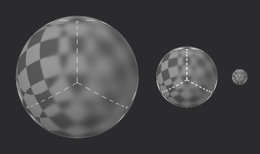
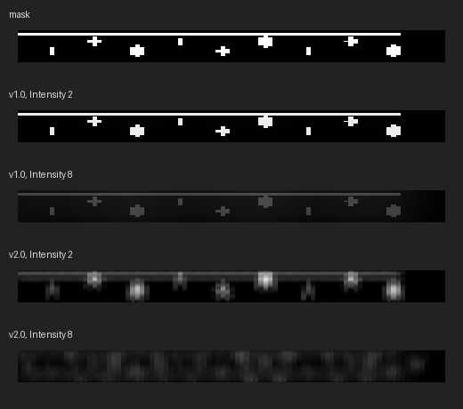
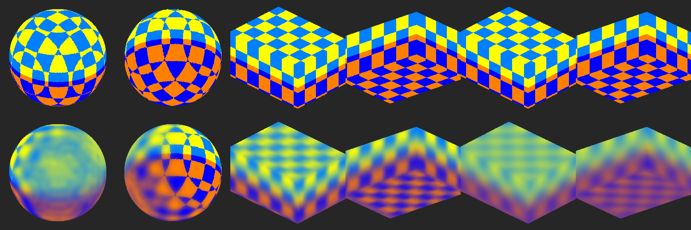
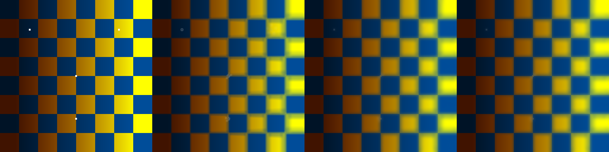

# World Space Non Uniform Blur

A Substance Designer / Substance Painter filter that does the **Non-Uniform Blur**
(bokeh blur scaled by a blur map, with Samples / Intensity / Anisotropy / Blades / Angle)
**in 3D, using the mesh position**, so the result is continuous across UV seams.
It is built on the same voxelization as *World Space Mask Blur v2.0*.

`world_space_non_uniform_blur_v2.0.sbs` (**version 2.0**, set by `VERSION` in `tools/build_wsnub.py`; it goes in the file name and the graph descriptions) contains two graphs:

| Graph | Use |
|---|---|
| `world_space_non_uniform_blur` | colour input / output (any channel) |
| `world_space_non_uniform_blur_grayscale` | grayscale input / output (masks) |

Icon (made by `tools/make_icon.py` in the style of the World Space Mask Blur icon, embedded in both graphs): the grey test sphere seen at the corner where three UV islands meet, its seams dashed. Its 3D checker is blurred by the filter itself with a left → right blur map, from crisp to melted, continuous across the seams.



## Inputs

| Input | |
|---|---|
| Input | the image to blur |
| Blur Map | optional grayscale map that scales the blur per texel (white = full Intensity, black = none). Only used when **Use Input As Blur Map** is off. |
| Mesh Position | the baked position map |
| Mesh UV Mask | the UV mask (texels outside it are passed through) |

## Parameters

**Blur** (same meaning as the 2D Non-Uniform Blur)

- **Samples** (1–16): the number of blur passes. Each pass averages the centre with `Blades` taps on a polygon, and the radius shrinks from pass to pass, which fills the bokeh shape.
- **Intensity**: the blur radius, in the same units as the 2D filter (1 = 1/256 of the UV space; default 10). It is converted to world space using the mesh's average texel density, so islands with very different texel density blur by the same world size rather than by the same number of pixels. It doesn't depend on how far apart the pieces are laid out.
- **Anisotropy**: squashes the shape across the Angle direction (1 = a line).
- **Blades** (1–9): the number of polygon sides.
- **Angle**: rotation of the shape around the surface normal.
- **Use Blur Map** (on by default): scale the blur per texel. When off, the blur is uniform.
- **Use Input As Blur Map** (on by default): use the luminance of the Input itself as the blur map, like plugging the layer below into both inputs of the 2D filter. Turn it off to use the Blur Map input instead.
- **Invert Blur Map**: blur the dark areas instead of the bright ones.

**World Space**

- **Softness**: blurs every tap a little. This makes the result smoother and lets the blur wrap around hard edges and curved areas. At 0 you get the sharpest bokeh shape.
- **Quality** (1–4): the voxel budget, 48³ / 64³ / 96³ / 128³ voxels, shared by all pieces.
- **Reference Axis X/Y/Z**: the object-space direction that Angle 0 points to. It is projected onto the surface. The default is +Y (up), so Anisotropy gives vertical streaks.
- **Dither**: hides 8-bit banding.

## Pieces laid out apart

A texture set often holds several pieces spread over the scene: kit pieces,
trims and props laid out side by side. v1.0 put one voxel grid around the whole
layout, so the farther apart the pieces, the bigger every voxel: blurs smaller
than a voxel fell back to the unblurred input, and the smallest real blur could be
wider than a plank. v2.0 uses World Space Mask Blur v2.0's boxes:

1. The occupied space is projected onto X: empty columns between pieces split
   it into **slabs**.
2. Each slab is split the same way along Z, or along Y if that separates more.
3. Each resulting **box** is cut down to the exact bounds of its surface. Every
   box gets its own voxel grid, all with one voxel size, sharing the Quality budget.

The bokeh passes, their mip pyramid (Softness) and the final lookup all work
inside each box: a tap that leaves its box reads empty, like a tap that leaves the
surface. So pieces in different boxes **never blur into each other**. Pieces
closer than about 2 % of the layout's size share a box and blur together.



*A plank from a layout of 4 pieces spread over 19 units (`tools/wsb/layout_mesh.py`),
seen from above. v1.0 at Intensity 2 leaves it unblurred (the radius is below its
voxel size) and at Intensity 8 washes it out; v2.0 blurs both by the right amount.*

## How it works

1. **Voxelization** (World Space Mask Blur v2.0, vendored in `tools/wsb/` and used as is): 512×512 surface samples with area weights, a coarse sort to find the boxes, a fine sort of the samples into each box's cells.
2. **Splats**: each voxel gathers the samples of its box next to it (tent weights). One splat stores the surface normal (the dominant eigenvector of the normal tensor, so mirrored UV islands don't cancel out; mesh only), the other `(colour·w, blur amount·w)` (per stroke). Sample areas are relative to the mesh's mean sample area, so nothing depends on its size or units.
3. **Non-uniform passes** (up to 16): each voxel averages its centre and `Blades` taps. The taps sit on the 2D Non-Uniform Blur's ellipse (same angles, inner rotation, anisotropy and radius decay `exp(-2k·√(-ln 0.001)/N)` with `N = min(Samples, ⌈Intensity·π⌉)` passes), placed in the voxel's tangent plane and scaled by the voxel's blur amount. Taps read a 5-level per-box voxel mip pyramid, which is what Softness controls, so taps that leave the surface still find it.
4. **Resolve**: finds each texel's box, then a cubic B-spline lookup in it at the texel's position. It is blended with the original texel where the local radius is below about 2 voxels, so unblurred areas stay sharp.



Flat-plane comparison with the 2D Non-Uniform Blur (v1.0; input used as its own blur map, Intensity 10): input, 2D filter, this filter at Softness 0.25, this filter at Softness 0. v2.0 is 10× closer to the 2D filter on this plane (see below).



## Quality and performance

Measured by running v1.0 and v2.0 through the interpreter at full size, Quality 4,
Intensity 10, 4 Samples (`tools/bench_v2.py`). Work is counted as executed: texture reads and
function-node evaluations with every loop at its real length and both sides of every If/Else,
so it's an upper bound, not a timing. The full-resolution pass (the final lookup) is scaled to a
**2048² texture**.

| Scene | Finest voxel v1.0 → v2.0 | Per stroke (reads / node evals) v1.0 → v2.0 | Once per mesh or Quality v1.0 → v2.0 |
|---|---|---|---|
| Sphere (one object) | 0.0164 → 0.0161 (1.0×) | 1.58 G / 51 G → **1.20 G / 43 G** (−24 %) | 0.29 G / 8 G → 1.98 G / 41 G |
| Kit layout, 4 pieces | 0.158 → 0.0120 (**13×** finer) | 1.55 G / 52 G → 1.38 G / 52 G | 0.29 G / 8 G → 1.97 G / 41 G |
| Flat plane | 0.0081 → 0.0014 (5.9× finer) | 1.79 G / 68 G → 2.09 G / 90 G | 0.29 G / 8 G → 1.87 G / 39 G |

* **Per stroke** = what reruns when you paint below the filter or move a Blur slider.
  It's lower on the sphere because the normals splat no longer reruns per stroke and
  the colour splat skips empty voxels. On flat pieces it's higher: the grid now follows
  the piece's proportions, so more voxels hold surface (which is also why it's so much closer to
  the 2D filter there: mean difference 0.0133 → **0.0013**).
* **Once per mesh or Quality**: two sorts instead of one, the boxes, and the normals
  splat. Painter caches it, so it costs nothing while you paint.
* If it's still slow: lower **Quality** (3 is about half the work of 4), and apply the
  filter only to the channels that need it, since Painter runs a filter once per channel.

## Testing

```
pip install numpy pillow scipy
python3 tools/test_v2.py            # reduced sizes, about a minute
```

`tools/sbsinterp.py` is a small numpy interpreter for pixel-processor graphs; the tests run the
generated `.sbs` itself, built at World Space Mask Blur's reduced test sizes. All pass:

* box, kit layout (4 pieces), 6 pieces in a row (more slabs than the small tables hold, so some
  merge), a column along Z and a stack along Y: the result is finite and blurred, and texels with
  a black blur map stay untouched;
* **pieces don't interact**: changing the input on one piece leaves every other piece's
  result exactly unchanged (4-piece layout, Z column, Y stack);
* **size and units don't matter**: the box and the layout scaled to 1/1000 give the same
  result (max difference 2.6 × 10⁻⁴, half-float rounding);
* the per-box mip pyramid equals a direct [1 3 3 1] / 8 downsample of each box's voxels
  (relative difference 5 × 10⁻⁴) and every mip entry maps back to its box.

`python3 tools/test_wsnub.py sphere out` renders the full-size test sphere, and
`tools/bench_v2.py` / `tools/plank_compare.py` make the numbers and the image above. The
interpreter also runs the original World Space Mask Blur correctly.

## Rebuilding

The package is generated by a script; don't edit the `.sbs` by hand:

```
python3 tools/build_wsnub.py       # writes world_space_non_uniform_blur_v2.0.sbs (checks Get node types)
python3 tools/make_icon.py         # re-renders docs/icon/ (runs the graph; then rebuild to embed)
```

`tools/wsb/` holds unmodified copies of World Space Mask Blur v2.0's generator and reference
(see `tools/wsb/README.md`); update it by copying the files again.

## Versions

* **2.0**: pieces laid out apart get their own voxel grids (13× finer on a spread-out
  layout) and don't blur into each other; the voxel grid follows each piece's proportions
  (6× finer on a flat piece, 10× closer to the 2D filter there). Quality is a voxel budget
  shared by the pieces. Fixed: the "is there surface here" tests used absolute 3D areas, so
  small meshes or small units could leave texels unblurred; areas are now relative to the
  mesh's mean sample area. Per-stroke cost −24 % on a single object. Parameters are the
  same as 1.0. The v1.0 `.sbs` is in the git history (commit `933e48b`).
* **1.0**: first versioned release.

## Notes

- Tested with the interpreter above, not yet inside Substance Designer / Painter (v1.0 was
  used in Painter).
- The orientation of the bokeh (Angle, odd Blades) is mirrored on mirrored UV islands, as it is in the 2D filter.
  The Reference Axis can't be projected where the surface faces straight along it, so those spots fall back to the X (or Z) axis.
- Detail finer than one voxel can't be represented, so very small blurs are a little softer than the 2D filter's.
- Pieces closer than ~2 % of the layout's size share a box and can blur into each other, like any 3D blur.
